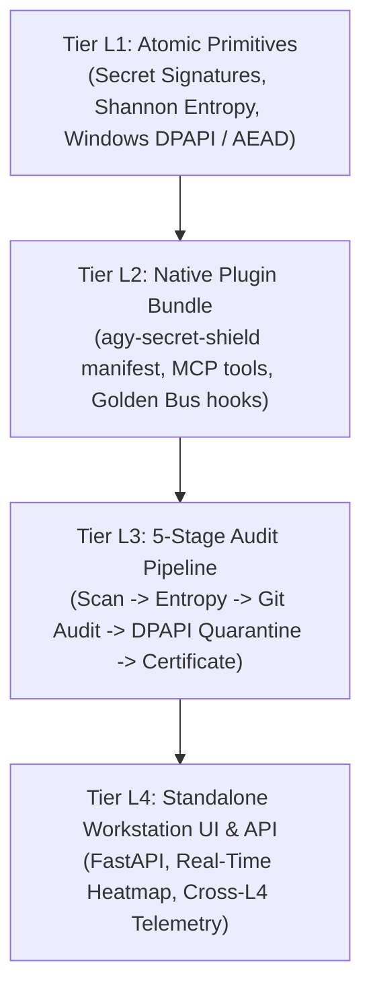

# AGY Secret Shield

[](LICENSE)
[](pyproject.toml)
[-purple.svg)](#4-tier-architecture)

4-Tier Autonomous Secret, Session Cookie, Shannon Entropy, and PII Quarantine Workstation with Windows DPAPI integration.

---

## 4-Tier Architecture



1. **Tier L1 (Atomic Primitives)**:
   - `SECRET_SIGNATURE_CATALOG`: 8+ credential taxonomies (`__Secure-1PSID`, `SAPISID`, `ghp_`, `gho_`, `AIza`, `sk-`, PEM blocks, local user profile paths).
   - `compute_token_entropy`: Shannon entropy scoring in bits per character.
   - `dpapi_seal_secret` / `dpapi_unseal_secret`: Machine-locked Windows DPAPI envelope encryption (`CryptProtectData`) with authenticated local AEAD fallback.
   - `scan_text_for_secrets`: In-place redaction replacing sensitive strings with `[REDACTED_DPAPI:<hash12>]`.

2. **Tier L2 (Native Plugin Bundle)**:
   - Clean manifest `plugin.json` compatible with AGY 2.0.
   - Root `hooks.json` consolidated into single-process `agy-golden-stack` bus.
   - MCP tools under `< 64` character schema constraint.

3. **Tier L3 (5-Stage Audit Pipeline)**:
   - `STAGE_1_SIGNATURE_AND_PII_SCAN`
   - `STAGE_2_SHANNON_ENTROPY_ANALYSIS`
   - `STAGE_3_GIT_HISTORY_AND_INDEX_AUDIT`
   - `STAGE_4_DPAPI_QUARANTINE_REDACTION`
   - `STAGE_5_CRYPTO_CLEAN_CERTIFICATE`

4. **Tier L4 (Workstation Web UI & Root Telemetry)**:
   - Standalone dark-mode workstation dashboard.
   - Interactive audit profile runner and DPAPI encryption vault.
   - Automated telemetry emission to Mission Control (`child_session_reports.jsonl`).

---

## Quickstart

```bash
# Run CLI 5-stage audit
python -m agy_secret_shield.cli audit --profile clean_repo --json

# Launch L4 Workstation Web UI
uvicorn agy_secret_shield.l4_app:app --port 8770 --reload
```

---

## Verification

```bash
pytest tests/test_secret_shield.py -v
```

---

## License

MIT (c) 2026 Obscured-grey.
